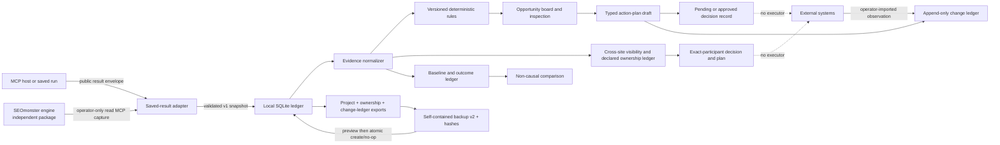
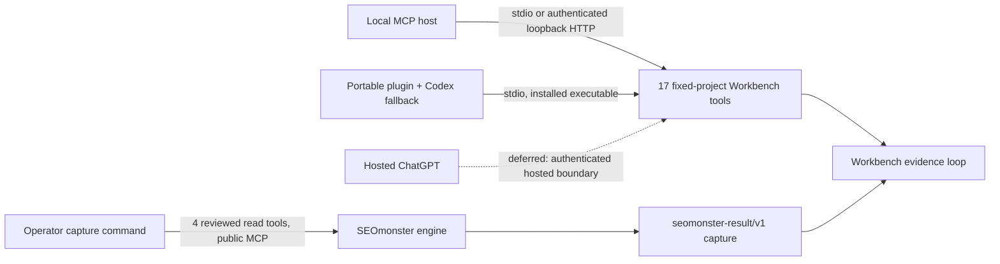
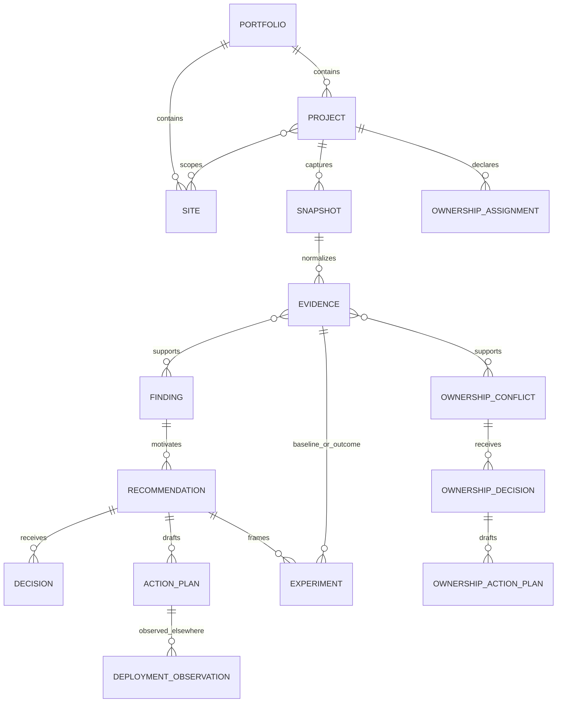

# Architecture

## Component view

The dotted external path is deliberately non-operational. The workbench contains no Cloudflare, Search Console, GA4, IndexNow, sitemap-submission, deployment, or publishing client.

### Implemented local host distribution and deferred hosted boundary

The plugin package and local facade are implemented; a hosted deployment is not. The MCP facade only reads or records local workbench data and never forwards arbitrary tool calls. Local record writes are labeled as writes. See `OPENAI_HOST_COMPATIBILITY.md` and ADR 0009 for host-specific evidence and remaining gates.

## Boundaries

### SEOmonster engine

Owns provider authentication, live data access, public tool schemas, prompt recipes, tool safety behavior, and the stable `{ok,data,error}` result envelope. It may ship on its own cadence.

### Adapter

Accepts `seomonster-result/v1`: tool name, arguments, capture time, freshness, provider and cost metadata, and the complete result envelope. It validates shape, hashes the complete capture, stores only the source filename as locator, and treats fetched strings as inert data. It imports no SEOmonster module.

### Persistence

SQLite is local, transactional, inspectable, and available in Python's standard library. Migrations are append-only numbered steps recorded in `schema_migrations`. Content-addressed snapshot and derived IDs make ingestion idempotent.

### Analysis

Normalizers create evidence records and explicit availability states. Versioned rules create findings and recommendations. A material recommendation is invalid unless it names input evidence, timestamp, rule ID/version, calculation, and caveats.

### Decision loop

Plans contain dependencies, reversible notes, and local-only steps. Decisions are separate records. Experiments bind a hypothesis, baseline evidence, observation window, later evidence, and a comparison whose causal claim is explicitly `none`.

### Portfolio ownership

Comparable GSC query/page evidence is grouped only by NFKC-normalized case and whitespace. A conflict requires observations attributed to at least two configured site scopes. The latest attributable snapshot for each site and resolved measurement scope participates, including zero-row snapshots that supersede older visibility without inventing zero. The conflict stores all evidence identifiers, pages, site scopes, timestamps, rule version, calculation, caveats, impact, and confidence.

Observed visibility never becomes intended ownership. Query/topic assignments are explicit operator records. Decisions cover one exact participant/evidence set; a changed snapshot or new participant creates a new open conflict. Decisions form one explicit supersession chain; ambiguous parallel legacy state is exposed, never silently selected. MCP tools may save only pending proposals. Final assignments and recorded decisions are CLI/operator assertions, and every resulting plan requires the sole current decision and remains non-executing.

### Interfaces

The CLI and optional MCP interface are primary open-source product surfaces and share the application service. The MCP facade scopes the database/project at startup and validates returned data before committing mutations. A future UI is deferred until the functional contracts mature; it must remain a thin consumer that owns no business rules and cannot bypass capability policy.

The portable plugin is a host adapter over this boundary. Neither host owns analytical rules, persistence semantics, or approval state. Hosted ChatGPT requires additional production authentication and validation; the localhost listener must not be mistaken for that deployment.

### Rule replay preview

Replay reconstructs one `AdaptedResult` from the immutable raw snapshot, verifies stored snapshot identity and project/site scope, then runs the installed normalizer and rules entirely in memory. It compares canonical analytical projections for evidence, findings, and recommendations; human recommendation state is excluded from the analytical digest. Added, removed, and changed identifiers plus dependent decisions, plans, and experiments are reported. No historical code is fabricated, no record is migrated, and no apply capability exists.

### Change observations

The operator CLI can import a strict local observation of a change performed elsewhere. The ledger freezes the plan as it existed at import, hashes the source document, and compares asserted approval timestamps with the observation timestamp. Missing preceding timestamps remain visible instead of blocking or erasing the observation. Because legacy decisions lack a separate immutable recording time, this is not attested authorization chronology. Verification labels are preserved operator assertions, not an execution result or causal conclusion. MCP exposes inspection only; no model-facing import or executor exists.

### Backup and restore

Project export v1 and ownership export v1 stay immutable. Change-ledger/v1 is separate. Backup/v2 wraps all three with the portfolio record, canonical component hashes, and an explicit create-or-exact-no-op policy; valid backup/v1 inputs remain restorable with an empty change ledger. Operator CLI preview performs complete graph and target-state validation without restoring records. Apply uses one SQLite transaction and then verifies exact replay before commit. Any conflict refuses the operation; merge, overwrite, rename, deletion, approval, and external execution do not exist at this boundary. The MCP facade does not transport backups because exact JSON bytes and hashes must not pass through model argument transcription.

## Entity relationships

SQLite storage schema 3 adds deployment observations while retaining the schema 2 ownership tables. Portable project export v1 and ownership/v1 remain unchanged; change-ledger/v1 is separate and backup/v2 composes all three. Backup/v1 remains accepted for backward-compatible restore.

## Data-state semantics

| State | Meaning |
|---|---|
| `observed` | The provider returned a value. Zero is allowed only when it is the returned value. |
| `unavailable` | Missing, empty, failed, or unconfigured data. It is never numerically coerced. |
| `current` | The capture declares itself suitable for current analysis. |
| `stale` | The capture declares itself stale; rules reduce confidence. |
| `unknown` | Freshness cannot be established; current-state inference is unavailable. |
| `recommended` | A system recommendation exists. No human decision is implied. |
| `pending` | A plan awaits a human decision. |
| `approved` | A human decision was recorded. No execution token is implied. |
| `outcome_observed` | Later evidence was compared to baseline. Causation remains unestablished. |
| deployment `reported` | An operator reports a change performed elsewhere; no artifact or postcondition verification is implied. |
| deployment `artifact_observed` | An operator reports inspecting a referenced artifact or receipt; the workbench did not execute it. |
| deployment `postcondition_verified` | An operator asserts a later postcondition check; SEO causation is still unestablished. |
| `open` ownership conflict | Comparable cross-site visibility exists; no current exact-participant decision is recorded. |
| `pending` ownership decision | An agent/local proposal exists; no final operator assertion is implied. |
| `recorded` ownership decision | An operator asserted `accept`, `differentiate`, `consolidate`, or `route`; no execution is implied. |
